# Despliegue automático en Vercel
 
Proyecto: CI/CD Cloud Económico para Aplicaciones Web con GitHub Actions y Hosting Gratuito (Grupo SN_#3, ESIT, Fase 2).
Última actualización: 10/11/2026.
 
## 1. Resumen
- Plataforma de hosting: **Vercel** (plan Hobby, gratuito). Proyecto: `cicd-cloud-app`.
- Quién despliega: **solo GitHub Actions** (`.github/workflows/main.yml`). La integración Git nativa de Vercel está desconectada (Vercel → Settings → Git no tiene repositorio conectado).
- Ramas de Vercel: en Settings → Environments, *Production* no tiene "branch tracking". El despliegue a producción lo decide la opción `--prod` del workflow, no una rama configurada en Vercel.
## 2. Flujo de despliegue
| Evento | Jobs que corren | Resultado |
|---|---|---|
| Pull Request hacia `dev` o `main` | lint, test, build | Solo validación; no se despliega |
| Push a `dev` | lint, test, build, **deploy-dev** | Despliegue *Preview* |
| Push a `main` | lint, test, build, **deploy-prod** | Despliegue a *Producción* (`--prod`) |
 
El despliegue espera a la integración continua: `build` tiene `needs: [lint, test]` y los jobs `deploy-dev` y `deploy-prod` tienen `needs: build`. Si lint, test o build fallan, **no se despliega**. El diagrama completo está en `docs/mapa_logico_pipeline.png`.
 
## 3. Pasos del job de despliegue
1. `actions/checkout@v4` y `actions/setup-node@v4` (Node 22).
2. `npm install --global vercel@latest`.
3. `vercel pull --yes --environment=preview|production --token="$VERCEL_TOKEN"`.
4. `vercel build` (con `--prod` en producción).
5. `vercel deploy --prebuilt` (con `--prod` en producción), con **hasta 3 intentos** y 10 segundos de espera entre intentos.
6. La URL resultante se escribe en el resumen del run (`GITHUB_STEP_SUMMARY`).
## 4. Secretos (solo nombres)
Configurados en GitHub → Settings → Secrets and variables → Actions:
 
| Secreto | Uso |
|---|---|
| `VERCEL_TOKEN` | Autenticación del CLI de Vercel |
| `VERCEL_ORG_ID` | Identifica la cuenta/equipo de Vercel |
| `VERCEL_PROJECT_ID` | Identifica el proyecto `cicd-cloud-app` |
 
Los valores nunca se escriben en el repositorio ni se imprimen en los logs. El workflow declara `permissions: contents: read`.
 
## 5. Primer despliegue a Preview (dev)
- Fecha: 03/11/2026 · Run #50 · commit `107d2f7`.
- Todos los jobs en verde; Deploy Dev: 24 s.
- URL Preview: https://cicd-cloud-mwogemt8n-cicd-cloud-app.vercel.app
- Vercel Authentication desactivada para que la URL sea pública.
## 6. Despliegue a Producción
- Fecha: 06/11/2026 · Run #65 · commit `db73451` (merge del PR #15, `dev` → `main`).
- Todos los jobs en verde; duración total 59 s; Deploy Producción: 26 s. Deploy Dev se omitió, como corresponde en `main`.
- URL del despliegue: https://cicd-cloud-ec7gcde2g-cicd-cloud-app.vercel.app
- Resultado: la página "CI/CD Cloud Económico – Estado: en línea" se publica correctamente (captura del 10/11/2026).
## 7. Problemas y soluciones
| Problema | Causa | Solución |
|---|---|---|
| La URL devolvía 404 | La aplicación no tenía ninguna página que servir | Se agregó `public/index.html` (PR #5, commit `9137dd3`) |
| La URL pedía inicio de sesión de Vercel | Vercel Authentication (Deployment Protection) activa por defecto | Se desactivó en Settings → Deployment Protection |
| Despliegue colgado en *Building* (más de 12 min en 3 intentos; run cancelado a los 14 min) | Cola de despliegues de Vercel saturada por re-ejecuciones y despliegues duplicados | Se canceló el run, se evitaron re-runs repetidos y se dejó que desplegara solo Actions (run #50 correcto) |
| Despliegues *Blocked* en Vercel | Vercel (plan Hobby) bloquea el despliegue si el email del autor del commit no coincide con una cuenta con acceso al proyecto (ej. commit `2c6ef0d` en `dev`). Afectó a Preview, no a producción | Se desconectó la integración Git de Vercel; el despliegue lo hace únicamente GitHub Actions |
| Push a `dev` desplegaba con `--prod` | Un solo job de deploy con `--prod` | Se separaron `deploy-dev` y `deploy-prod` por rama (PR #2) |
| `npm` fallaba al usar caché | Faltaba `package-lock.json` | Se generó y versionó el lockfile (commit `c242469`) |
 
## 8. Rollback
1. Revertir el commit o PR defectuoso con un Pull Request de reversión hacia `dev` y luego hacia `main`; el pipeline vuelve a desplegar la versión anterior.
2. O bien, desde el dashboard de Vercel, volver a promover el último despliegue en estado *Ready*.
3. Regla operativa: no se une a `main` ni se despliega a producción si lint, test o build fallaron.
## 9. Mejoras pendientes
- Agregar `timeout-minutes` a los jobs de deploy (un run llegó a 6 h antes de que GitHub lo cancelara).
- Agregar un health check posterior al despliegue.
- Ignorar cambios de documentación en el disparador (`paths-ignore`).
- Activar protección de ramas (Pull Request y checks obligatorios en `main` y `dev`).
- Revisar de forma controlada las vulnerabilidades de `npm audit`.
## 10. Evidencias
Las capturas están en `docs/evidencias/` (ver lista al final).
 
- `docs/mapa_logico_pipeline.png`: mapa lógico del pipeline.
- Run #50 (Deploy Dev) y run #65 (Deploy Producción) en la pestaña Actions.
- `docs/matriz_riesgos_tecnicos actualizada.pdf`: matriz de riesgos técnicos.
- Capturas de Vercel (Settings → Git, Environments, despliegue *Blocked*) y de la página en producción.
## 11. Capturas
 
### Pipeline
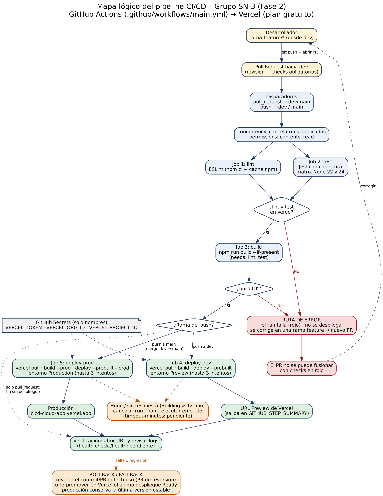
 
### Checks del PR #2 y primer run
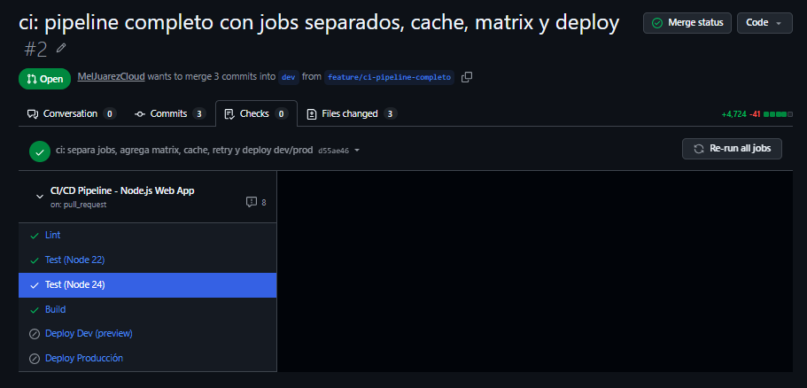
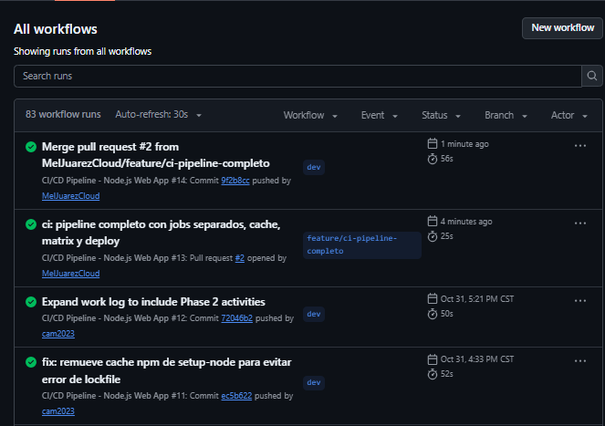
 
### Despliegue a Preview (dev)
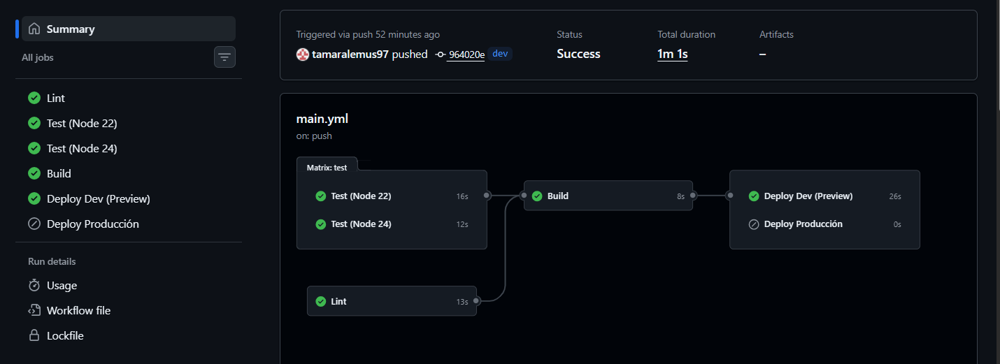
 
### Despliegue a producción (main)
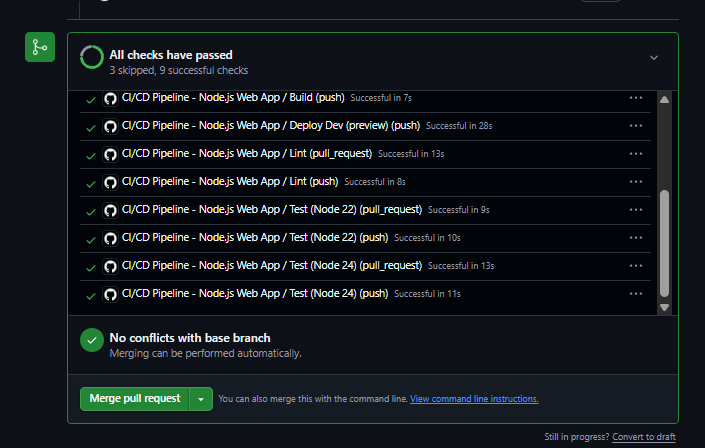
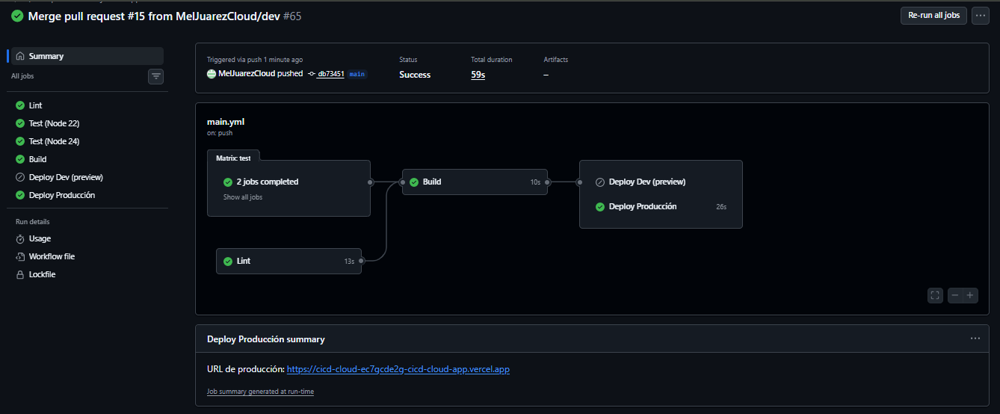
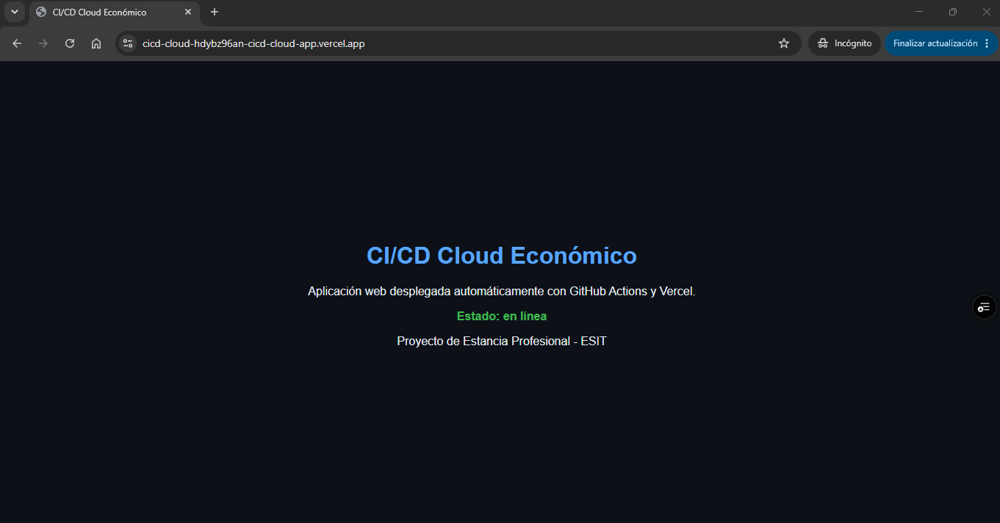
 
### Configuración en Vercel y GitHub
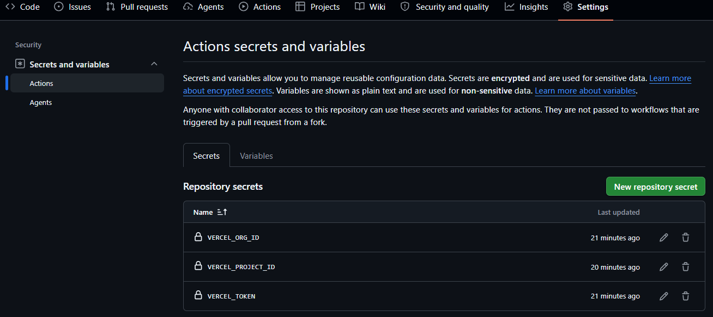
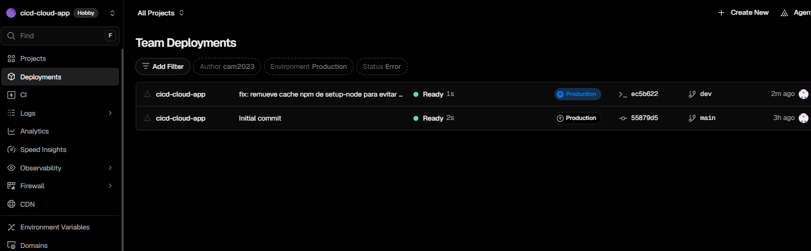
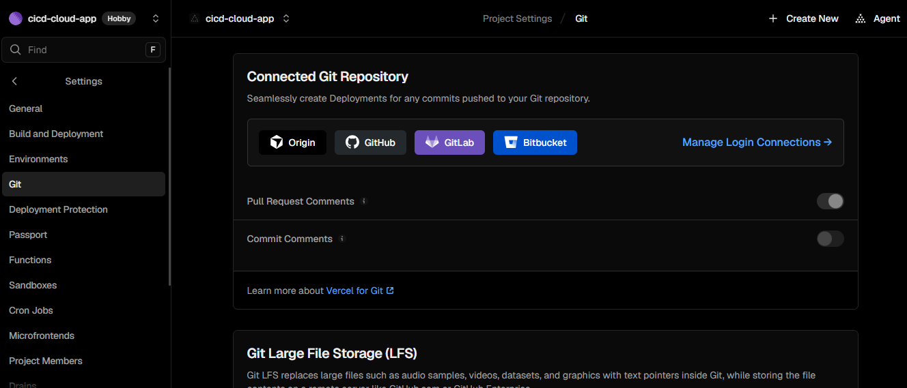
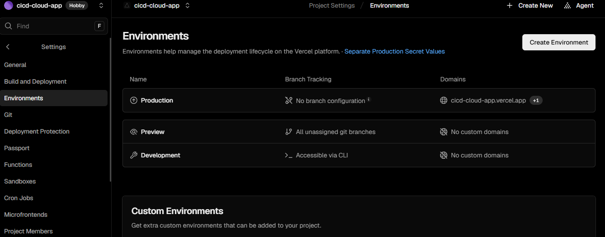
 
### Problemas
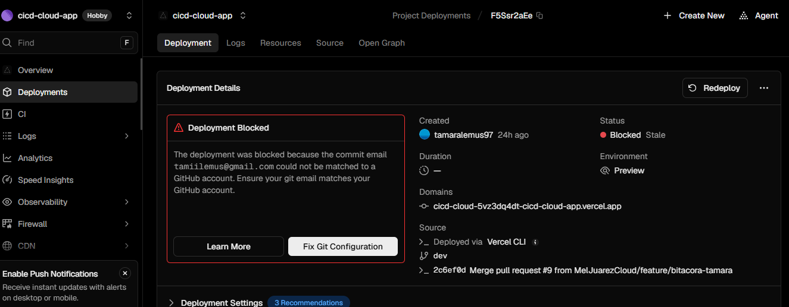
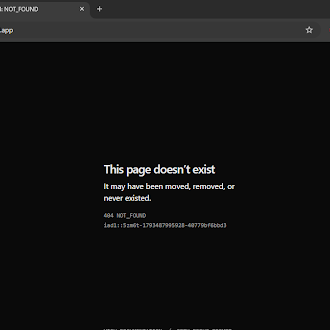
