# Matriz de pruebas CI/CD – Fase 3

Proyecto: CI/CD Cloud Económico para Aplicaciones Web (Grupo SN_#3, ESIT).
Fechas de ejecución: del 18 al 23/11/2026 (los escenarios 4 y 5 los ejecutó Carlos Martínez; los demás, Melvin Juárez el 23/11/2026).
Pipeline: `.github/workflows/main.yml` (lint, test Node 22/24, build, deploy-dev, deploy-prod).

## 1. Resumen de escenarios

| ID | Escenario | Resultado esperado | Resultado real | Run / PR | Responsable |
|---|---|---|---|---|---|
| E1 | Build exitoso | Lint, Test y Build en verde; se genera `dist/` | Cumplido. `Build OK: dist/ generado con 2 archivo(s)` | PR #21 | Melvin Juárez |
| E2 | Build fallido | Build en rojo; deploys omitidos; PR bloqueado | Cumplido. Build ✗ en 13 s; Lint y Test en verde | Run #90 (PR #27) | Melvin Juárez |
| E3 | Test fallido | Test en rojo; Build y deploys omitidos | Cumplido. 4 de 13 pruebas fallan; Build omitido | Run #92 (PR #27) | Melvin Juárez |
| E4 | Deploy con error | Deploy Dev en rojo; producción no se ejecuta | Cumplido. El paso de error simulado detiene el deploy | Run #82 | Carlos Martínez |
| E5 | Deploy exitoso | Todos los jobs en verde con smoke test | Cumplido. `Smoke test correcto` | Run #83 | Carlos Martínez |
| E6 | Rollback | Revertir un cambio ya desplegado y volver a desplegar la versión anterior | Cumplido con `git revert` (PR #29); redeploy en verde | PR #28 → run #95; PR #29 → run #97 | Melvin Juárez |

## 2. Detalle por escenario

### E1. Build exitoso
- **Precondición:** rama `feature/ci-fase3` con `scripts/build.cjs`, `public/health.json` y el workflow actualizado.
- **Pasos:** abrir PR #21 hacia `dev` y esperar los checks; después, fusionar y revisar el run en `dev`.
- **Resultado esperado:** Lint, Test (Node 22 y 24) y Build en verde; artefacto `dist`.
- **Resultado real:** Lint 9 s, Test Node 22 12 s, Test Node 24 11 s, Build 13 s. El log del paso de build muestra `Build OK: dist/ generado con 2 archivo(s)`. El run posterior en `dev` terminó en verde, con Deploy Dev (38 s), `Smoke test correcto` y los artefactos `dist`, `cobertura-node-22` y `cobertura-node-24`.
- **Causa → efecto:** el script valida `public/index.html`, copia `public/` a `dist/` y termina con código 0, de modo que los jobs dependientes continúan.
- **Corrección:** no aplica.
- **Evidencia:**
  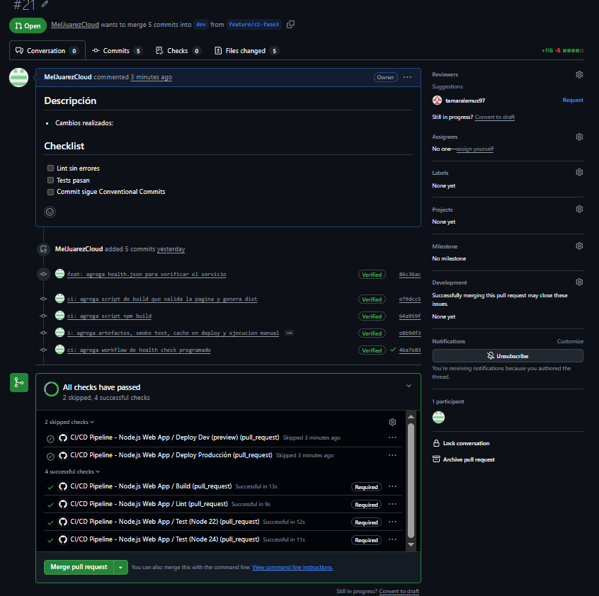
  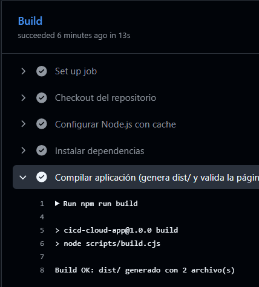
  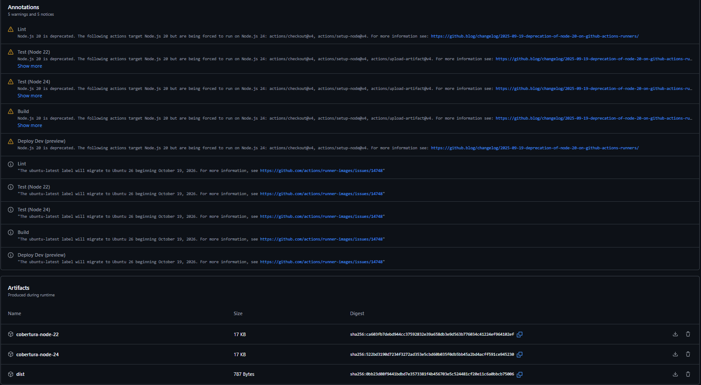

### E2. Build fallido
- **Precondición:** rama `feature/prueba-fallos` creada desde `dev` y PR #27 abierto hacia `dev`.
- **Pasos:** en `public/index.html` se reemplazó `CI/CD Cloud Económico` por `Mi Pagina` en el `<title>` y en el `<h1>` (commit `22ae750`).
- **Resultado esperado:** Build en rojo, Deploy Dev y Deploy Producción omitidos, botón de merge deshabilitado.
- **Resultado real:** run #90 (33 s). Lint ✓ (12 s), Test Node 22 ✓ (10 s), Test Node 24 ✓, **Build ✗ (13 s)**, deploys omitidos, botón de merge deshabilitado. El log muestra `ERROR: public/index.html no contiene el titulo del proyecto` y `Process completed with exit code 1`.
- **Causa → efecto:** `scripts/build.cjs` exige que la página contenga `CI/CD Cloud`; al no encontrarlo termina con código 1, el job Build falla y, como los deploys dependen de Build, no se ejecutan. Las pruebas unitarias no cubren el HTML en ese momento, por eso Test pasó.
- **Corrección:** se restauró el título en `index.html` (commit `fix: restaura el titulo del proyecto`).
- **Evidencia:**
  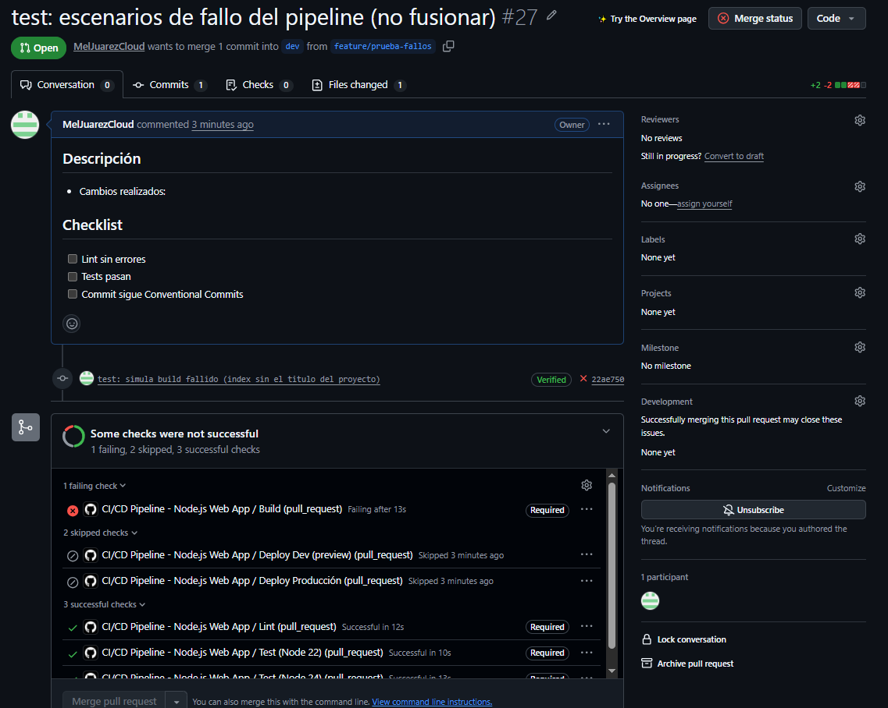
  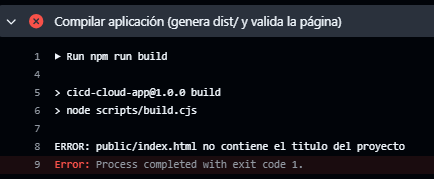

### E3. Test fallido
- **Precondición:** el mismo PR #27, con el título ya restaurado.
- **Pasos:** en `src/sum.js` se cambió `return a + b;` por `return a - b;` (commit `test: simula test fallido (sum resta)`).
- **Resultado esperado:** Test (Node 22 y 24) en rojo; Build y deploys omitidos.
- **Resultado real:** run #92 (16 s). Lint ✓, **Test Node 22 ✗ y Test Node 24 ✗**, Build omitido, Deploy Dev y Deploy Producción omitidos. El resumen de Jest indica `Test Suites: 1 failed, 4 passed, 5 total` y `Tests: 4 failed, 9 passed, 13 total`. Un ejemplo: en `suma numeros decimales`, `sum(0.1, 0.2)` esperaba `0.3` y recibió `-0.1`.
- **Causa → efecto:** la función restaba en lugar de sumar; las pruebas unitarias detectaron la regresión, el job Test falló y, por `needs: [lint, test]`, Build y los despliegues no se ejecutaron. El código con el defecto no llega a ningún entorno.
- **Corrección:** se restauró `return a + b;` (commit `fix: restaura sum`). El run #93 (30 s) terminó con los 4 checks obligatorios en verde. El PR #27 se cerró sin fusionar.
- **Evidencia:**
  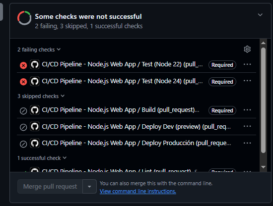
  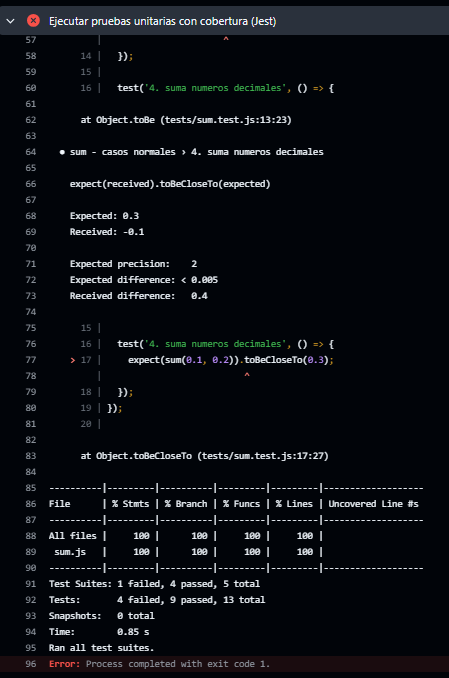
  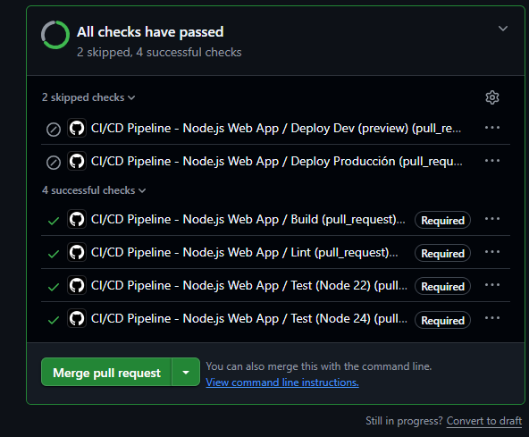

### E4. Deploy con error (fallo controlado)
- **Precondición:** `main.yml` con el disparador `workflow_dispatch` y el input booleano `simular_error`.
- **Pasos:** Actions → CI/CD Pipeline → Run workflow sobre la rama `dev`, con `simular_error` activado.
- **Resultado esperado:** Lint, Test y Build en verde; Deploy Dev en rojo; Deploy Producción omitido.
- **Resultado real:** run #82 (Failure, 1 min 9 s, lanzado por Carlos Martínez). Lint ✓ (9 s), Test ✓✓, Build ✓ (19 s), Deploy Dev ✗ (26 s) por el paso "Simular error de despliegue (solo ejecución manual)", que termina con `exit 1`. No se publica ninguna versión nueva.
- **Causa → efecto:** el error es intencional y no toca secretos ni la configuración de Vercel; el job falla antes de `vercel deploy` y el pipeline se detiene.
- **Corrección:** ejecutar de nuevo con `simular_error` desactivado (E5).
- **Evidencia:**
  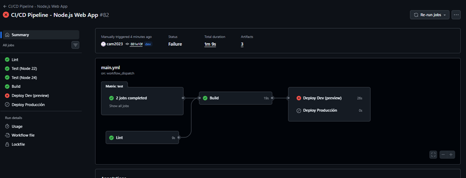

### E5. Deploy exitoso
- **Precondición:** misma configuración que E4.
- **Pasos:** Run workflow sobre `dev` con `simular_error` desactivado.
- **Resultado esperado:** todos los jobs en verde y smoke test correcto.
- **Resultado real:** run #83 en verde (Success, 1 min 6 s): Lint 8 s, Build 9 s, Deploy Dev 28 s, 3 artefactos. Deploy Dev ejecuta el smoke test (consulta la URL y `/health.json`) y escribe `Smoke test correcto` en el resumen.
- **Causa → efecto:** el despliegue termina bien y la verificación posterior confirma que el sitio responde.
- **Corrección:** no aplica.
- **Evidencia:**
  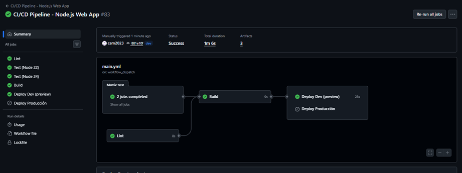

### E6. Rollback
- **Precondición:** `dev` estable y desplegada. En Vercel (plan Hobby), *Instant Rollback* y *Promote to Production* aparecen deshabilitados en los despliegues *Preview* (revisión de Carlos), por lo que la reversión se hace desde el repositorio.
- **Pasos:**
  1. PR #28 (`feature/cambio-rollback` → `dev`): se agrega `(v0.3.0)` al texto de `index.html`. Merge y run #95 (commit `32e9310`) en verde, con `Smoke test correcto`.
  2. Desde el PR #28 ya fusionado se usó el botón **Revert**, que creó el PR #29 (`revert-28-feature/cambio-rollback`, commit `cc68aec`). Los 4 checks pasaron y se fusionó.
  3. El push a `dev` (commit `d312008`) disparó el run #97, que terminó en verde en 1 min 9 s, con Deploy Dev en 32 s y `Smoke test correcto`.
- **Resultado esperado:** el cambio queda deshecho y el pipeline vuelve a desplegar la versión anterior.
- **Resultado real:** el diff del PR #29 muestra `-1 +1` en `public/index.html` (se elimina `(v0.3.0)`); el redeploy terminó en verde.
- **Causa → efecto:** la reversión es un commit nuevo que pasa por las mismas puertas de calidad (lint, test, build y smoke test), así que la versión anterior se restaura sin saltarse controles y queda trazabilidad en el historial.
- **Corrección:** no aplica. Tiempo total del procedimiento: unos 10 minutos, dominado por la espera de los checks.
- **Evidencia:**
  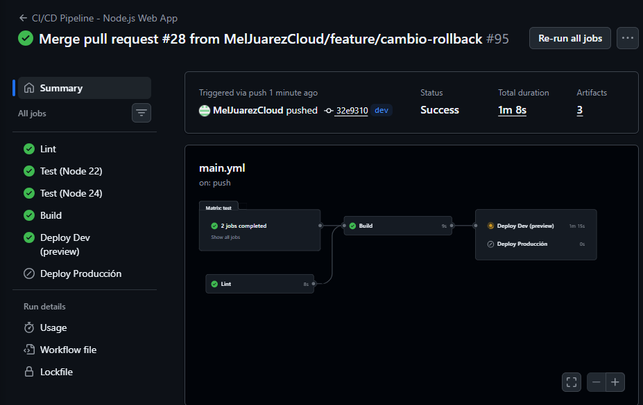
  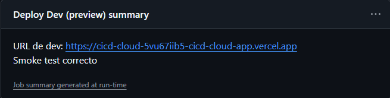
  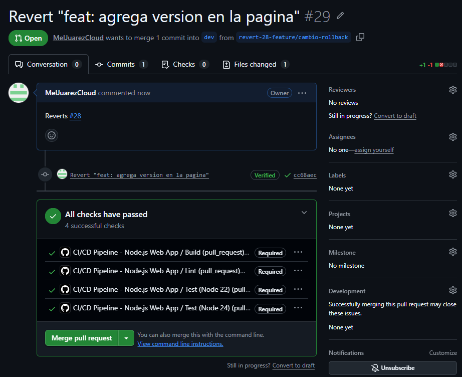
  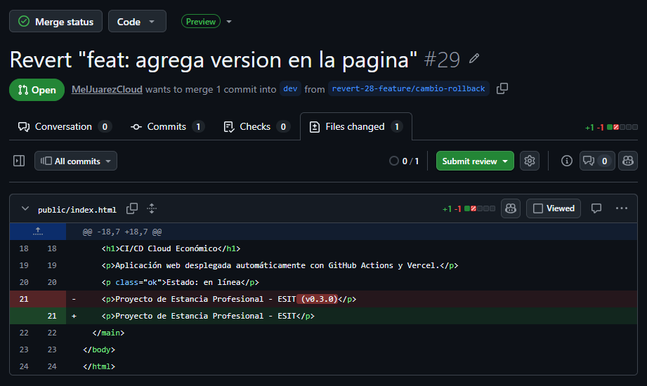
  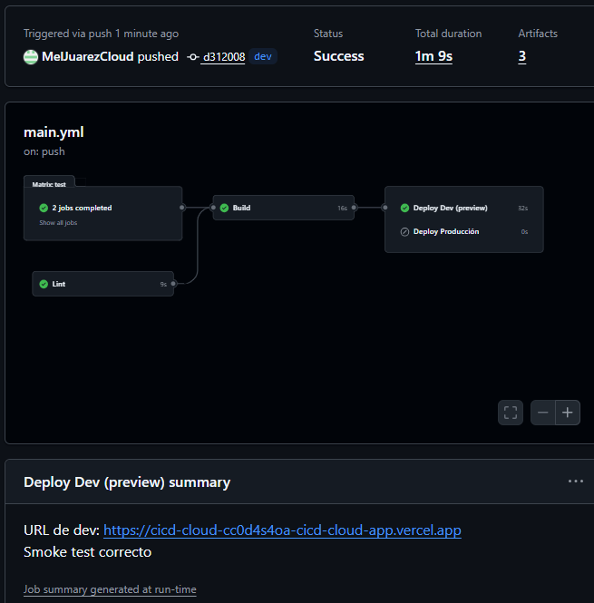
  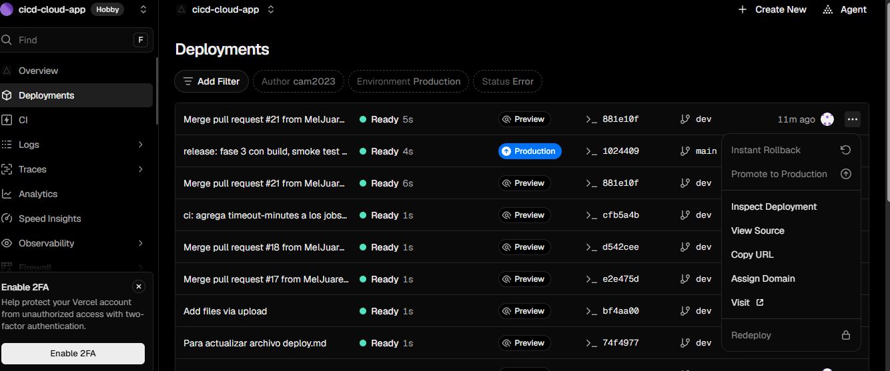
